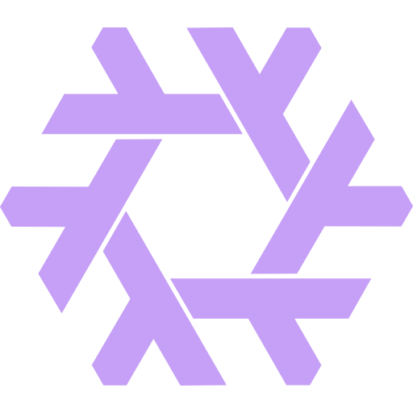
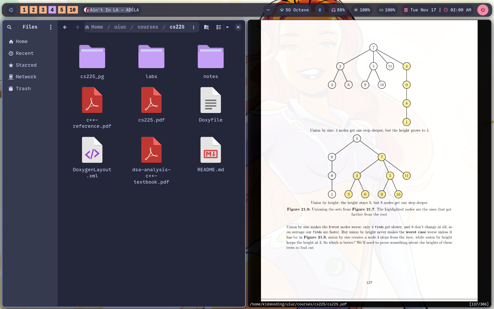

<div align="center">



# nixos-config

my nixos config that sets up my entire machine via flakes and home-manager

[](https://nixos.org)
[](https://codeberg.org/kidskoding/nixos-config/actions)
[](https://github.com/YaLTeR/niri)
[](https://github.com/catppuccin/nix)


</div>

<details>
<summary><b>more screenshots ✨</b></summary>
<br>

| | |
|---|---|
|  |  |
| clean desktop | launcher |
|  |  |
| control center | myx and cava |
|  |  |
| zen browser and obsidian | nautilus and zathura |
|  |  |
| neovim in zellij | btop and lazygit in zellij |
|  | |
| overview | |

</details>

## contents

- [what's inside](#whats-inside)
- [layout](#layout)
- [rebuilding](#rebuilding)
- [templates](#templates)

## what's inside

| | |
|---|---|
| **compositor** | [niri](https://github.com/YaLTeR/niri) |
| **shell / bar** | [noctalia](https://github.com/noctalia-dev/noctalia) |
| **theme** | [catppuccin/nix](https://github.com/catppuccin/nix) macchiato 🐈, with [stylix](https://github.com/nix-community/stylix) for fonts and the rest |
| **terminal** | ghostty, fish, starship, zellij |
| **editor** | neovim nightly ([kidskoding.nvim](https://codeberg.org/kidskoding/kidskoding.nvim)), evil-helix as backup |
| **secrets** | [sops-nix](https://github.com/Mic92/sops-nix) 🤫 |
| **disks** | [disko](https://github.com/nix-community/disko) |
| **layout** | [dendritic](https://github.com/mightyiam/dendritic), with [flake-parts](https://github.com/hercules-ci/flake-parts) and [import-tree](https://github.com/vic/import-tree) |

## layout

the config is split by feature. every `.nix` file under
`modules/` loads on its own, and each one adds its settings to a named group,
like `flake.homeModules.dev`. the laptop is just a list of the groups it wants!
to see which group a file belongs to, peek at its first few lines.

```
.
├── configuration.nix   system settings, hostname, hardware bits (nixosModules.base)
├── hardware-configuration.nix, disko.nix   generated hardware and disk layout
├── home.nix            home packages and settings (homeModules.base)
├── modules/
│   ├── base.nix        plugs configuration.nix and home.nix into base, lists the laptop's groups
│   ├── dev.nix, theme.nix, …     one-file features
│   ├── niri/, shell/, git/, …    bigger features: default.nix plus helper files
│   └── settings.nix    nix settings and binary caches
├── templates/          flake templates for new projects
└── scripts/            rebuild helpers
```

### home groups

| group | what's in it |
|---|---|
| `base` | shell, git, cli tools, theme |
| `dev` | every language, neovim, helix (or `dev-core` plus `dev-rust`, `dev-web`, …) |
| `agents` | coding agents and their config |
| `desktop`, `niri` | gui apps, fonts, compositor, clipboard |

### where to edit

| to change… | edit |
|---|---|
| a plain package or on/off program | `home.nix` |
| a tool with its own settings | the file for its group |
| a binary cache, so packages download prebuilt instead of compiling | `modules/settings.nix` |
| which groups the laptop gets | the `modules` list in `modules/base.nix` |

## rebuilding

`rebuild.sh` formats the nix files you changed and switches to the new system.
if the switch works, it commits and pushes too:

```sh
~/nixos/scripts/rebuild.sh
```

the `rebuild` fish alias runs it, and every rebuild also pushes neovim config
changes over to [kidskoding.nvim](https://codeberg.org/kidskoding/kidskoding.nvim).

ci checks formatting with alejandra and taplo, then evaluates the thinkpad.

## templates

starting points for new projects! each one builds the project with nix
straight from its lockfile.

| template | language | lockfile |
|---|---|---|
| `crane` | rust | `Cargo.lock` |
| `gomod2nix` | go | `go.sum` |
| `uv2nix` | python | `uv.lock` |
| `bun2nix` | bun | `bun.lock` |
| `pnpm2nix` | pnpm | `pnpm-lock.yaml` |
| `bundix` | ruby | `Gemfile.lock` |
| `gradle2nix` | gradle | `gradle.lock` |
| `elm2nix` | elm | `elm.json` |

```sh
nix flake init -t git+https://codeberg.org/kidskoding/nixos-config#crane
```
