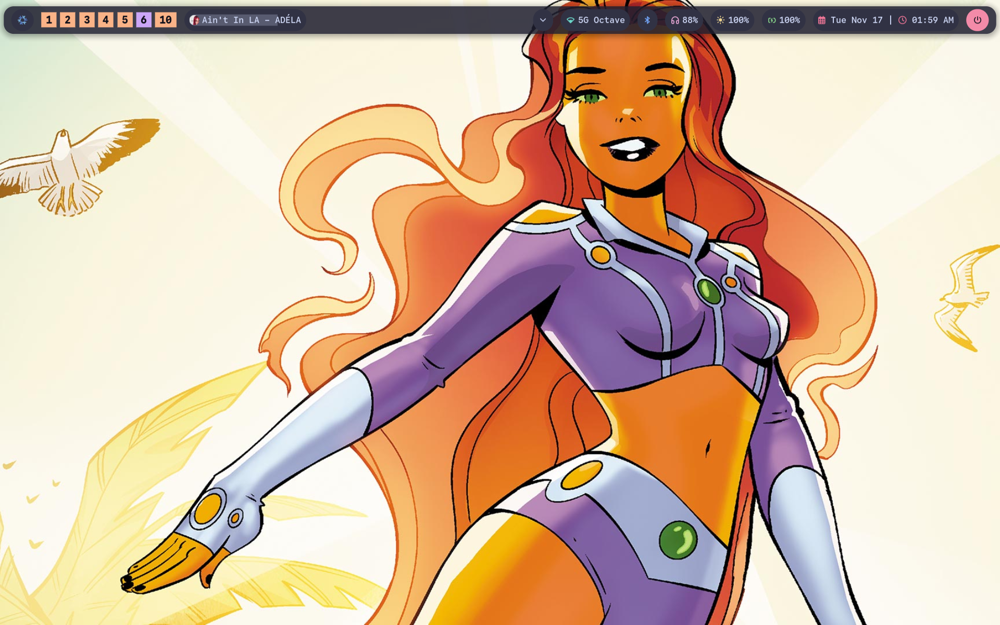
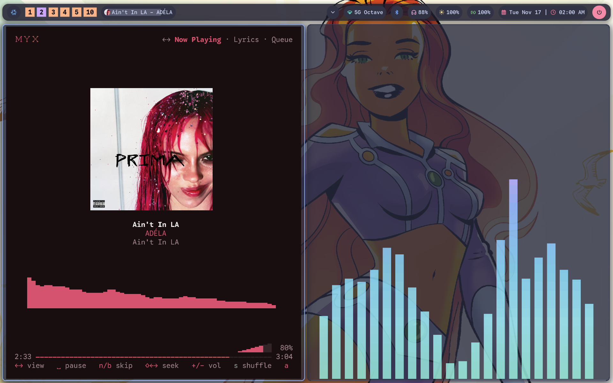
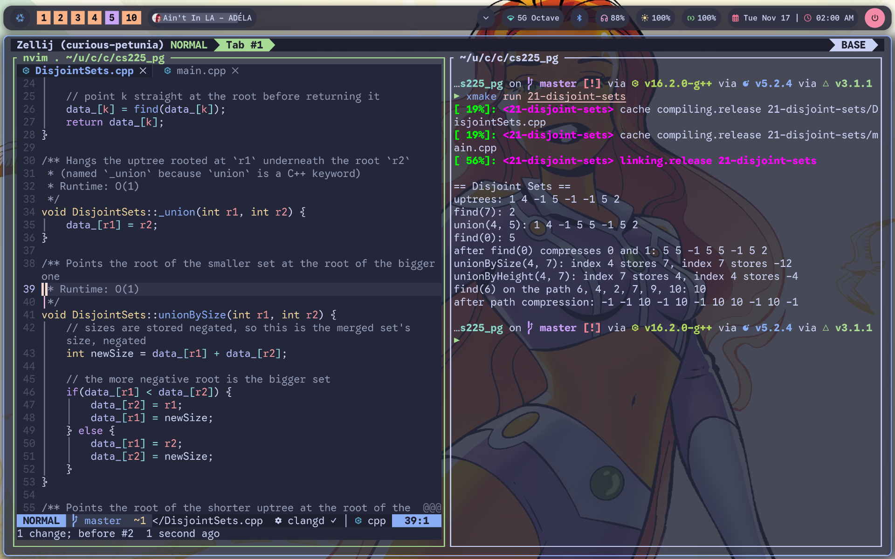
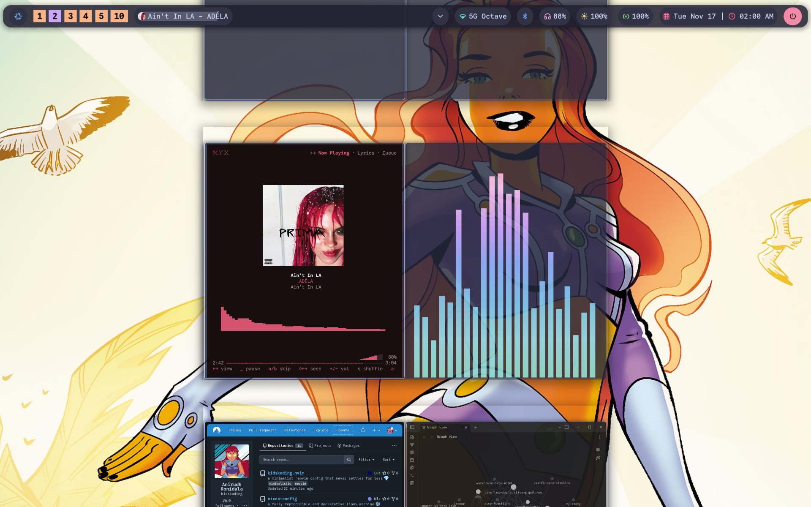

<div align="center">

# nixos-config

My NixOS flake for two laptops, plus a portable home-manager setup for any other Linux machine with Nix.

[](https://nixos.org)
[](https://codeberg.org/kidskoding/nixos-config/actions)
[](https://github.com/YaLTeR/niri)
[](https://github.com/catppuccin/nix)


</div>

<details>
<summary><b>More screenshots</b></summary>
<br>

| | |
|---|---|
|  |  |
| Clean desktop | Launcher |
|  |  |
| Control center | myx and cava |
|  |  |
| Zen browser and Obsidian | Nautilus and Zathura |
|  |  |
| Neovim in Zellij | btop and lazygit in Zellij |
|  | |
| Overview | |

</details>

## Contents

- [Stack](#stack)
- [Machines](#machines)
- [Layout](#layout)
- [Rebuilding](#rebuilding)
- [Templates](#templates)

## Stack

| | |
|---|---|
| **Compositor** | [niri](https://github.com/YaLTeR/niri) |
| **Shell / bar** | [noctalia](https://github.com/noctalia-dev/noctalia) |
| **Theme** | [catppuccin/nix](https://github.com/catppuccin/nix) macchiato, with [stylix](https://github.com/nix-community/stylix) for fonts and the rest |
| **Terminal** | ghostty, fish, starship, zellij |
| **Editor** | neovim nightly ([kidskoding.nvim](https://codeberg.org/kidskoding/kidskoding.nvim)), evil-helix as backup |
| **Secrets** | [sops-nix](https://github.com/Mic92/sops-nix) |
| **Disks** | [disko](https://github.com/nix-community/disko) |
| **Structure** | [dendritic](https://github.com/mightyiam/dendritic), with [flake-parts](https://github.com/hercules-ci/flake-parts) and [import-tree](https://github.com/vic/import-tree) |

## Machines

| Host | Hardware | Config |
|---|---|---|
| `thinkpad` | Daily driver, AMD graphics | [`modules/hosts/thinkpad.nix`](modules/hosts/thinkpad.nix) |
| `victus` | Gaming and CUDA, hybrid Intel + NVIDIA (PRIME offload) | [`modules/hosts/victus.nix`](modules/hosts/victus.nix) |

## Layout

The config is split by feature, not by machine. Every `.nix` file under
`modules/` loads automatically, and each file adds its settings to a named
group such as `flake.homeModules.dev`. A machine is a list of the groups it
wants. The first lines of a file show which group it belongs to.

```
.
├── configuration.nix   system settings every laptop gets (nixosModules.base)
├── home.nix            home packages and settings every machine gets (homeModules.base)
├── modules/
│   ├── base.nix        plugs configuration.nix and home.nix into base
│   ├── hosts/          NixOS machines: their groups and facts
│   ├── dev.nix, theme.nix, …     one-file features
│   ├── niri/, shell/, git/, …    larger features: default.nix plus helper files
│   └── settings.nix    Nix settings and binary caches
├── hosts/              hardware-configuration.nix and disko.nix per laptop
├── templates/          flake templates for new projects
└── scripts/            rebuild helpers
```

### Home groups

| Group | Contents | Used by |
|---|---|---|
| `base` | shell, git, CLI tools, theme | every machine |
| `dev` | every language, neovim, helix (or `dev-core` plus `dev-rust`, `dev-web`, …) | picked per machine |
| `agents` | coding agents and their config | picked per machine |
| `desktop`, `niri` | GUI apps, fonts, compositor, clipboard | both laptops |
| `gaming` | games | `victus` |

### Where to edit

| To change | Edit |
|---|---|
| A plain package or on/off program for every machine | `home.nix` |
| A tool with its own settings | the file for its group |
| A binary cache, so packages download prebuilt | `my.caches` in the file whose packages need it |
| What a laptop gets | the `modules` list in `modules/hosts/<host>.nix` |

## Rebuilding

`rebuild.sh` formats changed Nix files and switches to the new system. If the
switch works, it commits and pushes.

```sh
~/nixos/scripts/rebuild.sh              # thinkpad
HOST=victus ~/nixos/scripts/rebuild.sh  # victus
```

The `rebuild` fish alias runs the right command on each laptop. Each rebuild
also pushes Neovim config changes to
[kidskoding.nvim](https://codeberg.org/kidskoding/kidskoding.nvim).

CI checks formatting with alejandra and taplo, then evaluates both hosts.

## Templates

Starting points for new projects. Each one builds the project with Nix from
its lockfile.

| Template | Language | Lockfile |
|---|---|---|
| `crane` | Rust | `Cargo.lock` |
| `gomod2nix` | Go | `go.sum` |
| `uv2nix` | Python | `uv.lock` |
| `bun2nix` | Bun | `bun.lock` |
| `pnpm2nix` | pnpm | `pnpm-lock.yaml` |
| `bundix` | Ruby | `Gemfile.lock` |
| `gradle2nix` | Gradle | `gradle.lock` |
| `elm2nix` | Elm | `elm.json` |

```sh
nix flake init -t git+https://codeberg.org/kidskoding/nixos-config#crane
```
