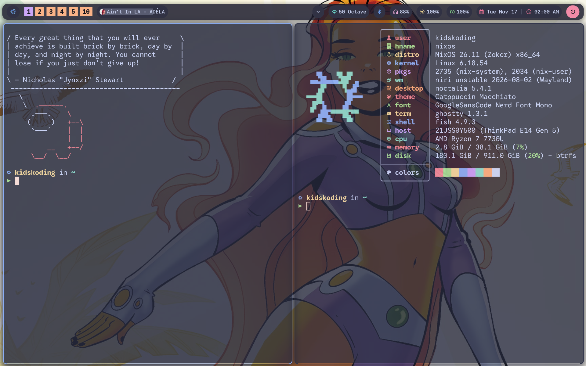
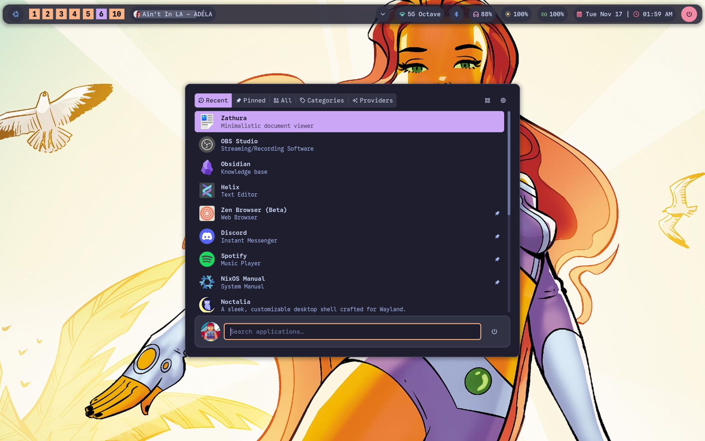
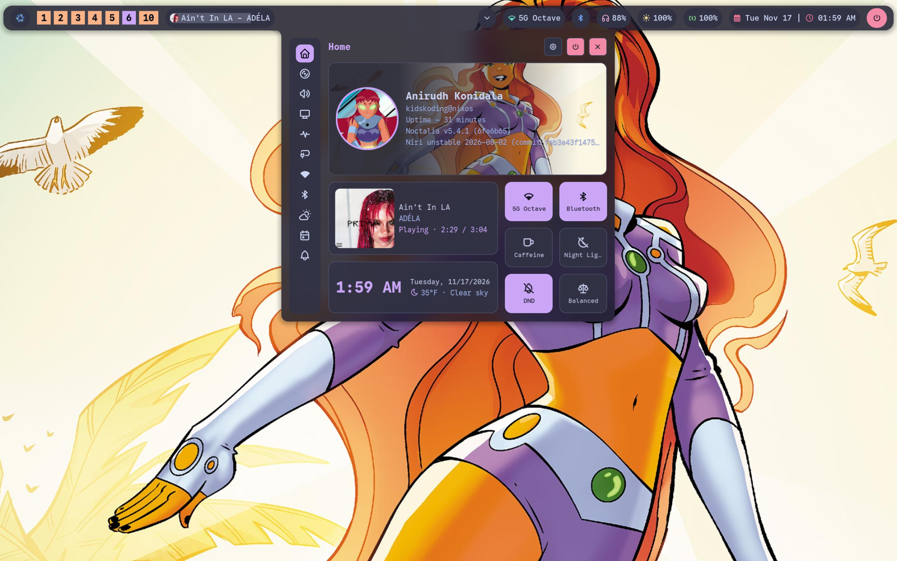
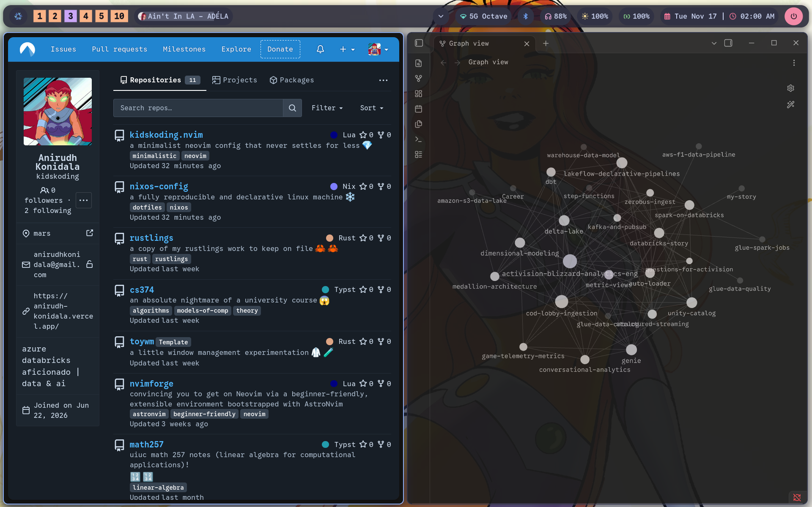
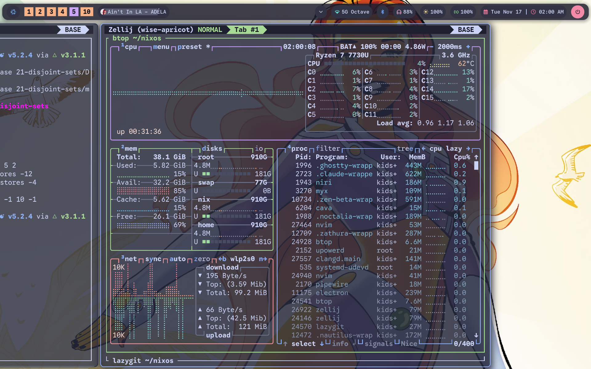

# nixos-config

my nixos config!! it sets up two laptops running nixos. the same shell,
editor and tools also install on any other linux machine with nix (wsl, other
distros) through home-manager, without nixos.



<details>
<summary>more screenshots</summary>











</details>

## what's inside

| | |
|---|---|
| compositor | [niri](https://github.com/YaLTeR/niri) |
| shell / bar | [noctalia](https://github.com/noctalia-dev/noctalia) |
| theme | [catppuccin/nix](https://github.com/catppuccin/nix) macchiato, [stylix](https://github.com/nix-community/stylix) for fonts and the rest |
| terminal | ghostty, fish, starship, zellij |
| editor | neovim nightly ([kidskoding.nvim](https://codeberg.org/kidskoding/kidskoding.nvim)), evil-helix as backup |
| secrets | [sops-nix](https://github.com/Mic92/sops-nix) |
| disks | [disko](https://github.com/nix-community/disko) |
| layout | [dendritic](https://github.com/mightyiam/dendritic), with [flake-parts](https://github.com/hercules-ci/flake-parts) + [import-tree](https://github.com/vic/import-tree) |

## machines

| name | what | config |
|---|---|---|
| `thinkpad` | daily driver laptop, amd | `modules/hosts/thinkpad.nix` |
| `victus` | gaming laptop, hybrid intel + nvidia graphics (prime offload), also for cuda | `modules/hosts/victus.nix` |

## layout

The config is split by feature, not by machine. Every `.nix` file under
`modules/` is loaded automatically, and each file adds its settings to a named
group, like `flake.homeModules.dev`. A machine is just a list of the groups it
wants. To see which group a file belongs to, read its first lines.

```
configuration.nix       system settings every laptop gets (nixosModules.base)
home.nix                home packages and settings every machine gets (homeModules.base)
modules/
├── base.nix            plugs configuration.nix and home.nix into base
├── hosts/              nixos machines: their groups and facts
├── users/              the user account and its base home
├── dev.nix, theme.nix, …    one-file features
├── niri/, shell/, git/, …   bigger features: default.nix plus helper files
└── settings.nix        nix settings and binary caches
hosts/                  hardware-configuration.nix and disko.nix per laptop
templates/              flake templates for new projects
scripts/                rebuild helpers
```

### home groups

| group | what | used by |
|---|---|---|
| `base` | shell, git, cli tools, theme | every machine |
| `dev` | every language, neovim, helix (or `dev-core` plus `dev-rust`, `dev-web`, …) | picked per machine |
| `agents` | coding agents and their config | picked per machine |
| `desktop`, `niri` | gui apps, fonts, compositor, clipboard | both laptops |
| `gaming` | games | victus |

### where to edit

- a plain package or on/off program every machine gets: `home.nix`
- a tool with its own settings: the file for its group
- a binary cache (prebuilt packages, so nothing compiles): add it to
  `my.caches` in the file whose packages need it
- what a laptop gets: the `modules` list in `modules/hosts/<host>.nix`

## nixos

`rebuild.sh` formats changed nix files, switches to the new system, then
commits and pushes if the switch worked:

```sh
~/nixos/scripts/rebuild.sh              # thinkpad
HOST=victus ~/nixos/scripts/rebuild.sh  # victus
```

The `rebuild` fish alias runs the right one on each laptop. Neovim config
changes are pushed to kidskoding.nvim as part of each rebuild.

## templates

Starting points for new projects. Each one builds the project with nix from
its lockfile:

| template | for |
|---|---|
| `crane` | rust (`Cargo.lock`) |
| `gomod2nix` | go (`go.sum`) |
| `uv2nix` | python (`uv.lock`) |
| `bun2nix` | bun (`bun.lock`) |
| `pnpm2nix` | pnpm (`pnpm-lock.yaml`) |
| `bundix` | ruby (`Gemfile.lock`) |
| `gradle2nix` | gradle (`gradle.lock`) |
| `elm2nix` | elm (`elm.json`) |

```sh
nix flake init -t git+https://codeberg.org/kidskoding/nixos-config#crane
```
