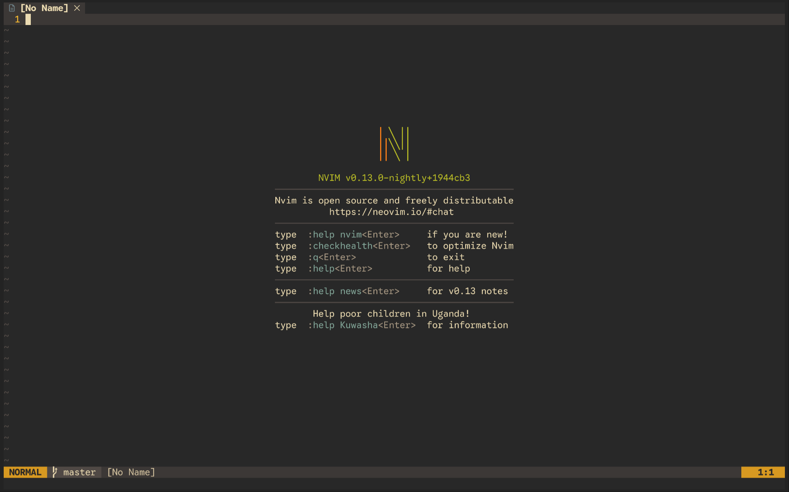
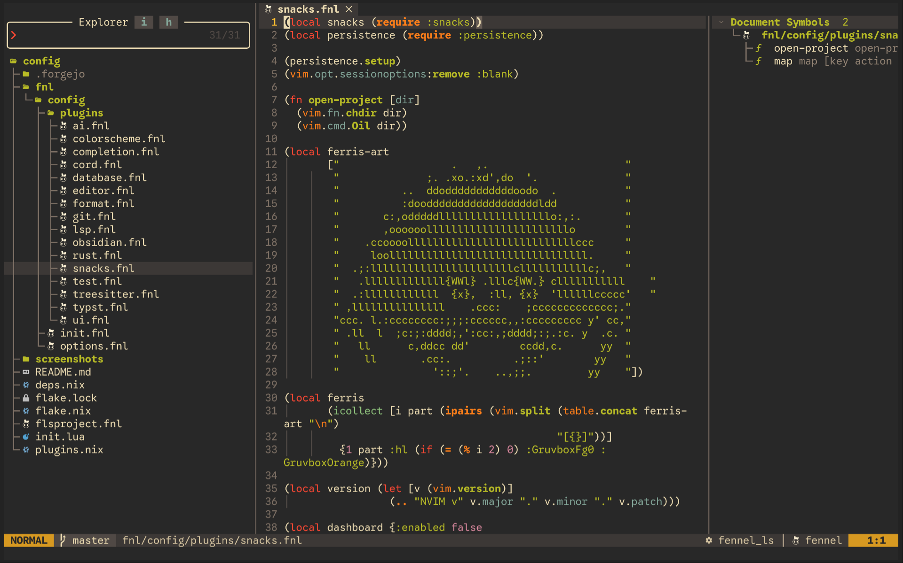

# kidskoding.nvim

a minimal Neovim config written in Lua!

plugins come from nixpkgs, listed in `plugins.nix`!





## Requirements

- [nix (the package manager)](https://nixos.org/download/): it brings Neovim, every plugin, tool, LSP, and formatter
- a Nerd Font (for icons)

## Install

run it in one command!

```sh
nix run git+https://codeberg.org/kidskoding/kidskoding.nvim
```

the first run copies the config into `~/.config/nvim` if nothing is there yet (an existing config is used as is). try it in a separate, clean profile with:

```sh
NVIM_APPNAME=nvim-test nix run git+https://codeberg.org/kidskoding/kidskoding.nvim
```
